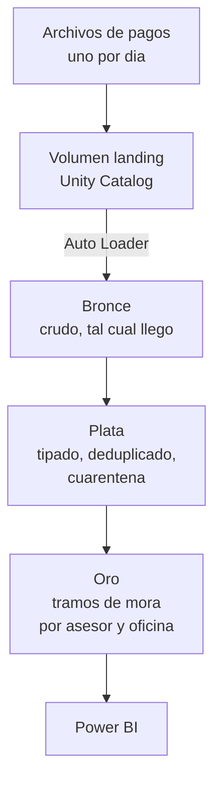

# Plataforma de datos de cartera y cobranzas

Pipeline en Azure Databricks que recibe los pagos de una cartera de créditos,
los limpia y produce el reporte de mora por asesor y oficina. Arquitectura
medallón sobre Delta Lake, con ingesta incremental.

Es la continuación del [warehouse dimensional de créditos](https://github.com/Axel12fuentes/warehouse-dimensional-creditos):
los créditos que allí se colocan son los que aquí se cobran.

> **Estado:** bronce, plata y oro funcionando. Pendiente: modelo estrella en
> oro, orquestación y despliegue.

---

## El problema

Una institución de microfinanzas desembolsa créditos y cada uno genera un
cronograma de cuotas. Todos los días llega un archivo con los pagos recibidos
por los distintos canales: app, agente, agencia, débito automático, Yape.

Con eso hay que responder, cada mañana:

- ¿Cuánto de la cartera está en mora, y en qué tramo?
- ¿Qué asesor tiene la cartera más deteriorada?
- ¿Qué oficina concentra el riesgo?

Y hay que responderlo sin reprocesar los seis meses anteriores cada vez.

---

## Arquitectura



### Las capas

| Capa | Tablas | Qué pasa ahí |
|---|---|---|
| **Volumen** `landing` | — | Los `.csv` tal como llegan. Si mañana cambia la lógica, se reprocesa desde aquí |
| **Bronce** | `cuotas`, `pagos` | Copia fiel, más columnas técnicas de auditoría. Ninguna regla de negocio |
| **Plata** | `cuotas`, `pagos`, `pagos_cuarentena` | Tipos, validaciones, deduplicación. Lo inválido se aparta, no se tira |
| **Oro** | `cartera_mora`, `mora_por_oficina` | La pregunta del negocio, resuelta |

### Dos patrones de ingesta en el mismo pipeline

| Origen | Patrón | Por qué |
|---|---|---|
| `cuotas.csv` | Lote, carga única | El cronograma se entrega una vez |
| `pagos_historico.csv` | Lote, carga única | La historia se carga de golpe |
| `pagos_DDMMAAAA.csv` | **Auto Loader, incremental** | Llegan a diario y no se reprocesa lo anterior |

---

## Decisiones de diseño

| Decisión | Qué se eligió | Por qué |
|---|---|---|
| Ingesta de los pagos | **Auto Loader** | Lleva él mismo el control de qué archivos ya leyó. Sin marca de agua que mantener |
| Evolución de esquema | `rescue` | Una columna nueva del proveedor **no detiene el pipeline**: va a `_rescued_data` |
| Disparador | `availableNow` | Procesa lo pendiente y se apaga. Control incremental con costo de lote |
| Deduplicación | Por **llave de negocio**, no por id | El reintento del canal genera un `id_pago` distinto para el mismo pago |
| Conversión de tipos | `TRY_CAST` | Una fila mala no puede tumbar una carga completa |
| Filas inválidas | **Cuarentena**, no descarte | Descartar pierde la evidencia de qué entró y por qué se fue |
| Cálculo de la mora | `LEFT ANTI JOIN` | Mora = cuota vencida **sin** pago. El anti join lo dice directo |
| Tramos | 1-8, 9-30, 31-60, 61-90, +90 | Los que usa el sistema financiero peruano |
| Cómputo | **Serverless** | Arranca en segundos y se apaga solo: imposible olvidarlo encendido |

---

## Cómo reproducirlo

### 1. Generar los datos

Requiere el PostgreSQL del Proyecto 1 corriendo, de donde salen los créditos.

```bash
python scripts/generar_pagos.py
```

Produce en `datos/`:

| Archivo | Filas |
|---|---|
| `cuotas.csv` | 294.186 |
| `pagos_historico.csv` | 36.800 |
| `pagos_DDMMAAAA.csv` × 30 | 10.408 |

Semilla fija: la misma corrida genera siempre lo mismo. Y ensucia a propósito
una fracción de las filas —duplicados por reintento, espacios, montos en cero,
fechas vacías— para que la capa plata tenga trabajo real.

### 2. Montar Unity Catalog

```sql
-- notebooks/01_unity_catalog.sql
```

Catálogo `dev`, esquemas `bronce`, `plata`, `oro`, volúmenes `landing` y
`checkpoints`.

### 3. Subir los archivos

Catálogo → `dev` → `bronce` → `landing` → **Cargar en este volumen**.

### 4. Correr los cuadernos en orden

```
notebooks/02_bronce.py     Auto Loader
notebooks/03_plata.sql     limpieza y cuarentena
notebooks/04_oro.sql       tramos de mora
```

---

## Estructura

```
.
├─ notebooks/      Los cuadernos, en orden de ejecución
├─ scripts/        El generador de datos
├─ datos/          Los CSV (ignorados por git)
└─ docs/           Cuaderno de errores
```

---

## Avance

- [x] Unity Catalog: catálogo, esquemas, volúmenes
- [x] Bronce con Auto Loader incremental
- [x] Plata: tipado, deduplicación, cuarentena
- [x] Oro: tramos de mora por asesor y oficina
- [ ] Modelo estrella en oro
- [ ] Orquestación con Lakeflow Jobs
- [ ] Permisos: cada asesor ve solo su cartera
- [ ] Despliegue con Asset Bundles

---

Axel Daniel Fuentes · [LinkedIn](https://linkedin.com/in/afuentes12) · [GitHub](https://github.com/Axel12fuentes)
